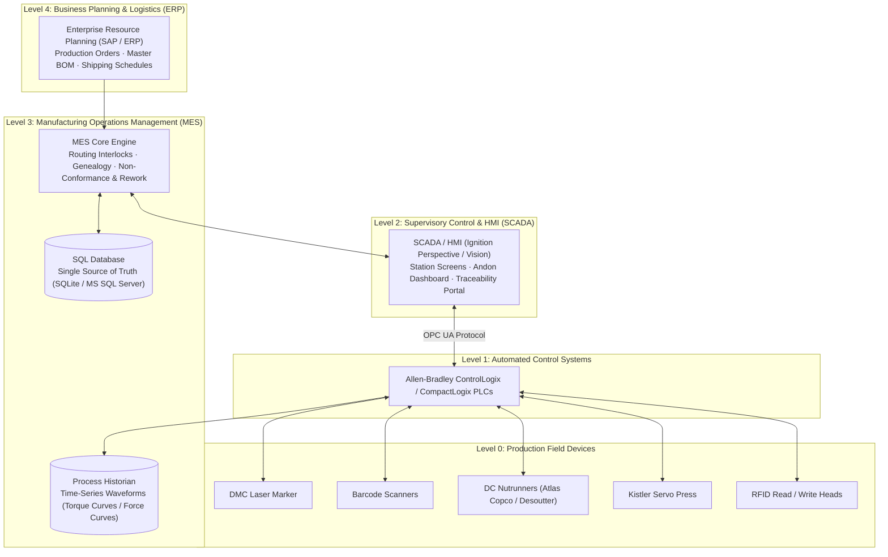
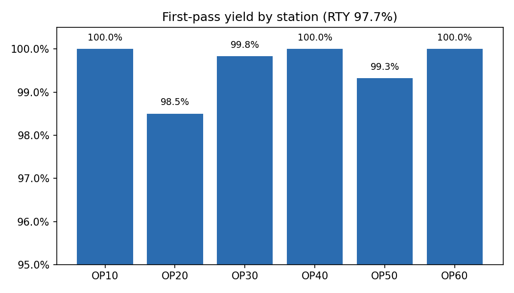
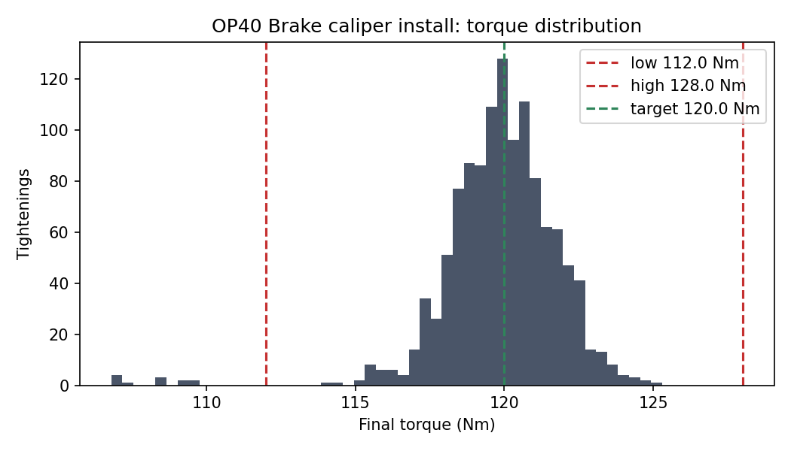

# Automotive MES Production Traceability & Quality Analytics

[](https://www.python.org/)
[](sql/schema.sql)
[](tests/)
[]()
[]()
[](LICENSE)

An enterprise-grade, discrete-manufacturing **Manufacturing Execution System (MES) Traceability and Quality Analytics platform** designed for automotive component assembly lines. The platform models end-to-end production operations, encompassing high-speed unit serialization, bi-directional PLC routing interlocks, bill-of-materials (*poka-yoke*) part validation, multi-spindle torque and servo-press monitoring, automated non-conformance quarantine and rework workflows, complete digital unit genealogy, and instant supplier-lot containment.

> **Portfolio Reconstruction Note:** This project models real-world discrete manufacturing MES/SCADA architectures originally deployed with Rockwell FactoryTalk ProductionCentre/MES, Inductive Automation Ignition, Allen-Bradley ControlLogix PLCs, and Microsoft SQL Server. The product (FSM-200 Front Suspension Module), serial prefixes, bill-of-materials, part numbers, and simulation datasets are entirely fictitious for demonstration and portfolio review purposes.

---

## Table of Contents

- [Overview & Problem Statement](#overview--problem-statement)
- [Key Features](#key-features)
- [System Architecture](#system-architecture)
  - [ISA-95 Enterprise Landscape](#isa-95-enterprise-landscape)
  - [PLC ↔ MES Real-Time Handshake Protocol](#plc--mes-real-time-handshake-protocol)
  - [Assembly Line Layout (FSM-200)](#assembly-line-layout-fsm-200)
- [Technology Stack](#technology-stack)
- [Project Directory Structure](#project-directory-structure)
- [Prerequisites & Installation](#prerequisites--installation)
- [Configuration](#configuration)
- [Execution & How to Run](#execution--how-to-run)
  - [Production Simulation](#production-simulation)
  - [Persisting Simulation to SQLite Database](#persisting-simulation-to-sqlite-database)
  - [Running the Automated Test Suite](#running-the-automated-test-suite)
- [Production Analytics & Output Artifacts](#production-analytics--output-artifacts)
  - [Simulation Results (600 Units / 1 Week Run)](#simulation-results-600-units--1-week-run)
  - [Containment & Genealogy Reporting](#containment--genealogy-reporting)
  - [Process Distribution Charts](#process-distribution-charts)
- [Database Schema & Named Queries](#database-schema--named-queries)
- [Testing & Quality Assurance](#testing--quality-assurance)
- [Known Limitations & Production Transition](#known-limitations--production-transition)
- [Future Roadmap](#future-roadmap)
- [License & Authors](#license--authors)

---

## Overview & Problem Statement

In mission-critical automotive component manufacturing (such as steering, braking, and suspension subassemblies governed by **IATF 16949**), component defects or assembly anomalies directly threaten passenger safety and brand liability.

Traditional production lines often suffer from:
1. **Unenforced Sequencing:** Assemblies accidentally bypassing mandatory torque or pressing stations without hard automated interlocks.
2. **Variant Mismatches:** Operators mounting incorrect component variants (e.g., standard vs. performance calipers) onto mismatched chassis carriers.
3. **Uncontained Supplier Defects:** When a tier-2 supplier issues an 8D recall on a defective batch (e.g., faulty piston seals), identifying which finished vehicles or pallets contain the affected lot often takes days of manual log auditing.
4. **Scattered Data Silos:** Process sensor readings (peak torque, angle curves, press forces) trapped in local machine controllers rather than linked directly to a unified digital birth history.

### Objectives Solved by this System

- **Zero-Defect Routing Gates:** Machine PLCs cannot index carrier fixtures or initiate cycle runs without explicit MES authorization via synchronous handshake tags.
- **Poka-Yoke Error Proofing:** Real-time barcode validation cross-references scanned component part numbers against the active variant BOM before physical assembly.
- **Microsecond Containment:** A single SQL containment query identifies every finished, in-transit, or palletized unit containing a quarantined supplier lot, complete with rack ID and RFID EPC.
- **Full Digital Birth History:** A tamper-evident digital thread recording laser serialization, part lot genealogy, press force/depth signatures, bolt torque/angle readings, visual inspection logs, and technician rework dispositions.

---

## Key Features

- **Unit Serialization & DMC Marking (OP10):** Assigns unique identifier tokens (`FSMyymmddNNNNN`) encoded into ISO/IEC 15434 Data Matrix Code (DMC) payloads.
- **Station-Level PLC ↔ MES Interlocks:** OPC UA state machine checking that prior operations are completed, unit is not scrapped, and no active non-conformance holds exist.
- **Variant BOM Verification:** Validates component part numbers against variant configurations (`FSM-200-STD` vs. `FSM-200-PERF`) preventing operator picking mistakes.
- **Duplicate Component Protection:** Enforces unique component serial usage in SQL; prevents relabeling fraud or duplicate assembly scans.
- **Servo Press Monitoring (OP20):** Evaluates pressing force (28.0–36.0 kN) and linear stroke depth (41.8–42.2 mm) against strict engineering tolerance windows.
- **Tightening / Torque Analytics (OP30 & OP40):** Evaluates torque (Nm) and angle (degrees) per bolt. Automatically permits one immediate re-hit attempt before triggering non-conformance quarantine.
- **Automated Non-Conformance (NC) & Andon:** Out-of-spec operations immediately transition unit status to `NC_HOLD`, fire factory floor Andon events, and divert carriers to rework bench `RW01`.
- **Rework & Scrap Dispositioning:** Tracks technician badge IDs, rework actions, and disposition flags. Reworked units are released strictly back to the failed operation.
- **Packaging & RFID EPC Tagging (OP60):** Aggregates units into container racks (12 units/rack) and generates standardized SGTIN-96 electronic product code (EPC) RFID payloads.
- **Single-Query Lot Containment:** Instant quarantine of all finished assemblies linked to a recalled raw-material or subcomponent lot.

---

## System Architecture

### ISA-95 Enterprise Landscape



### PLC ↔ MES Real-Time Handshake Protocol

Every automated and manual station follows a deterministic handshake before initiating physical tooling operations:

```mermaid
sequenceDiagram
    autonumber
    participant PLC as Station PLC
    participant MES as Traceability MES Core
    participant DB as SQL Database

    PLC->>MES: Write OPxx.Serial & set OPxx.ReqToMES = 1
    MES->>DB: Query Unit Status, Routing History & Active Holds
    DB-->>MES: Status Records
    alt Interlock Passed
        MES->>PLC: Set OPxx.MESRelease = 1, OPxx.MESReasonCode = 0, OPxx.MESAck = 1
        PLC->>PLC: Clear OPxx.ReqToMES; Station Cycle Executes (Press/Torque/Inspect)
        PLC->>MES: Post Process Sensor Results & set OPxx.ResultReady = 1
        MES->>DB: Store Station Result, Genealogy & Sensor Values
        MES->>PLC: Set OPxx.ResultAck = 1
        PLC->>PLC: Clear OPxx.ResultReady & release part fixture
    else Interlock Failed
        MES->>PLC: Set OPxx.MESRelease = 0, OPxx.MESReasonCode = [1..8], OPxx.MESAck = 1
        PLC->>PLC: Sound audible alarm, display reason code on HMI, divert to reject spur
    end
```

### Assembly Line Layout (FSM-200)

| Op | Station Name | Station Type | Equipment | Data Captured & Interlocks |
|---|---|---|---|---|
| **OP10** | Knuckle Load & Serialize | Serialize | Fiber Laser, DMC Camera | Knuckle serial generation, ISO 15434 DMC payload |
| **OP20** | Hub Bearing Press | Press & Scan | Electric Servo Press, 2D Scanner | Bearing part number, lot, serial, force (kN), depth (mm) |
| **OP30** | Strut Clamp Bolt Torque | Torque | 2-Spindle DC Nutrunner | Bolt 1 & 2 torque (Nm) and angle (°), retry counter |
| **OP40** | Brake Caliper Install | Torque & Scan | 2D Scanner, DC Nutrunner | Caliper variant poka-yoke, bolt torque & angle |
| **OP50** | End-of-Line Inspection | Inspection | Vision System / Manual Checklist | Visual aesthetics, caliper orientation, DMC readability |
| **OP60** | Pack & RFID Ship Label | Packaging | RFID Encoder, Label Applicator | Rack capacity assignment, SGTIN-96 RFID EPC write |
| **RW01** | Offline Rework Bench | Rework | Technician HMI terminal | Defect diagnosis, corrective action, rework/scrap disposition |

---

## Technology Stack

- **Core Programming Language:** Python 3.10+ (compatible with Python 3.10, 3.11, 3.12, 3.13)
- **Database Architecture:** ANSI SQL / SQLite (portable, in-memory or on-disk; structured for straightforward migration to Microsoft SQL Server / PostgreSQL)
- **Data Visualization & Analytics:** Matplotlib (headless Agg backend for automated figure generation)
- **Testing & Verification:** Pytest (comprehensive 23-test suite)
- **Industrial Standards:**
  - **ISA-95:** Enterprise-control system integration model (Levels 0–4)
  - **IATF 16949:** Automotive quality management standard for traceability
  - **ISO/IEC 15434:** High-capacity ADC media formatting for 2D Data Matrix
  - **EPCglobal Gen2 / SGTIN-96:** RFID Electronic Product Code encoding standard
  - **IEC 62541 (OPC UA):** Industrial communications address space and node identifiers

---

## Project Directory Structure

```
Automotive-MES-Traceability-Analytics/
│
├── config/
│   └── route_FSM-200.json           # Production routing, variant BOMs, and station tolerance limits
│
├── docs/
│   ├── Architecture.md              # ISA-95 model, Level 0-4 mapping, and station flow diagrams
│   ├── Functional_Spec_Interlocks.md# 13 interlock rules mapped to functions and test IDs
│   ├── Ignition_HMI_Screen_Spec.md  # Screen designs for Perspective line overview & Vision stations
│   ├── OPC_UA_Tag_Map.md            # Tag definitions, data types, writers, and MES reason codes
│   └── Test_Scripts_and_Containment.md# SAT test execution scripts and 5-step containment procedure
│
├── mes/
│   ├── __init__.py                  # Package exports (TraceabilityMES, TagServer, handshake, etc.)
│   ├── plc.py                       # Simulated OPC UA Tag Server and PLC-MES handshake logic
│   └── traceability.py              # MES core engine: routing, poka-yoke, process validation, NC, genealogy
│
├── output/
│   ├── figures/
│   │   ├── fpy_by_station.png       # Generated First-Pass Yield (FPY) by station chart
│   │   ├── torque_OP30.png          # OP30 tightening torque distribution vs. specification limits
│   │   └── torque_OP40.png          # OP40 tightening torque distribution vs. specification limits
│   ├── birth_history_example.md     # Full digital birth history example for a reworked unit
│   ├── containment_report.csv       # Quarantine report listing affected units, racks, and RFID tags
│   ├── kpi_summary.json             # Aggregated operational KPIs (outcomes, FPY, RTY, Pareti, Andon)
│   └── opcua_tag_snapshot.json      # Snapshot of all simulated OPC UA tag paths and values
│
├── sql/
│   ├── schema.sql                   # Relational database schema with indexes and integrity constraints
│   └── traceability_queries.sql     # Production analytics queries (FPY, RTY, Pareto, containment, birth history)
│
├── tests/
│   └── test_traceability.py         # Pytest suite with 23 unit and integration test cases
│
├── .gitignore                       # Clean Git ignore file for Python, IDEs, databases, and OS caches
├── LICENSE                          # MIT License
├── pytest.ini                       # Test configuration with pythonpath and test directory
├── requirements.txt                 # Clean dependency declarations
└── simulate.py                      # One-week production simulation script (CLI entry point)
```

---

## Prerequisites & Installation

### Prerequisites

- **Python:** Version 3.10 or higher.
- **Git:** Version 2.30 or higher.

### Installation

1. **Clone the repository:**
   ```bash
   git clone https://github.com/Jash275/Automotive-MES-Traceability-Analytics.git
   cd Automotive-MES-Traceability-Analytics
   ```

2. **Create and activate a virtual environment:**
   - **Linux / macOS:**
     ```bash
     python3 -m venv .venv
     source .venv/bin/activate
     ```
   - **Windows (PowerShell):**
     ```powershell
     python -m venv .venv
     .venv\Scripts\Activate.ps1
     ```

3. **Install required dependencies:**
   ```bash
   pip install -r requirements.txt
   ```

---

## Configuration

Production routing, bill-of-materials, and process tolerance envelopes are configured in JSON at [`config/route_FSM-200.json`](config/route_FSM-200.json):

```json
{
  "product": "FSM-200",
  "serial_prefix": "FSM",
  "variants": {
    "FSM-200-STD":  {"caliper": "CAL-4410-S", "bearing": "HB-7720"},
    "FSM-200-PERF": {"caliper": "CAL-4410-P", "bearing": "HB-7720"}
  },
  "stations": [
    {
      "op": "OP20",
      "name": "Hub bearing press",
      "type": "press",
      "press_force_kn": {"low": 28.0, "high": 36.0},
      "press_depth_mm": {"low": 41.8, "high": 42.2},
      "scan_component": "bearing"
    },
    {
      "op": "OP30",
      "name": "Strut clamp bolt torque",
      "type": "torque",
      "bolts": 2,
      "torque_nm": {"low": 95.0, "target": 100.0, "high": 105.0},
      "angle_deg": {"low": 30.0, "high": 60.0},
      "max_retries": 1
    }
  ]
}
```

Modifying parameters in this file immediately updates engineering limits without modifying python code.

---

## Execution & How to Run

### Production Simulation

Run the automated one-week line simulation (600 serialized units across mixed variants):

```bash
python simulate.py --units 600
```

#### Command-Line Arguments

| Flag | Type | Default | Description |
|---|---|---|---|
| `--units` | `int` | `600` | Number of serialized assemblies to build through the route |
| `--seed` | `int` | `11` | Random generator seed ensuring deterministic, repeatable results |
| `--db` | `str` | `:memory:` | SQLite database destination (`:memory:` or file path e.g. `output/mes.db`) |

### Persisting Simulation to SQLite Database

To inspect the raw relational database with SQLite tools, DBeaver, or Python:

```bash
python simulate.py --units 600 --db output/production.db
```

Query the database directly using the provided analytical queries:

```bash
sqlite3 output/production.db "SELECT op, COUNT(*) FROM station_result GROUP BY op;"
```

### Running the Automated Test Suite

Execute the full suite of unit and integration tests with verbose reporting:

```bash
pytest -v
```

---

## Production Analytics & Output Artifacts

### Simulation Results (600 Units / 1 Week Run)

```json
{
  "units_started": 600,
  "outcomes": {
    "PACKED": 586,
    "PACKED_AFTER_REWORK": 6,
    "SCRAP": 8
  },
  "rolled_throughput_yield": 0.9766,
  "first_pass_yield_by_station": [
    {"op": "OP10", "fpy": 1.0000},
    {"op": "OP20", "fpy": 0.9850},
    {"op": "OP30", "fpy": 0.9983},
    {"op": "OP40", "fpy": 1.0000},
    {"op": "OP50", "fpy": 0.9932},
    {"op": "OP60", "fpy": 1.0000}
  ],
  "torque_first_hit": [
    {"op": "OP30", "first_hit_ok_rate": 0.9916},
    {"op": "OP40", "first_hit_ok_rate": 0.9899}
  ],
  "containment": {
    "lot": "L-CAL-2207",
    "affected_units": 148,
    "racks": ["RACK-0025", "...", "RACK-0038"],
    "new_use_blocked": true
  },
  "open_nonconformances": 0,
  "andon_events": 21
}
```

### Containment & Genealogy Reporting

- **Quarantine Report ([`output/containment_report.csv`](output/containment_report.csv)):** Lists every affected knuckle serial number, variant, final disposition, physical shipping rack ID, and RFID EPC tag for instant warehouse isolation:
  ```csv
  lot,part_number,serial,variant,status,rack,rfid_epc
  L-CAL-2207,CAL-4410-P,FSM22030800301,FSM-200-PERF,PACKED,RACK-0025,30340000000000000000012D
  L-CAL-2207,CAL-4410-S,FSM22030800302,FSM-200-STD,PACKED,RACK-0025,30340000000000000000012E
  ```
- **Digital Birth History ([`output/birth_history_example.md`](output/birth_history_example.md)):** Detailed audit record tracing an individual unit from initial laser marking, through component scans, servo press force/depth signatures, torque/angle logs, inspection NOK, rework bench repair, and final pallet packaging.
- **OPC UA Address Space Snapshot ([`output/opcua_tag_snapshot.json`](output/opcua_tag_snapshot.json)):** Tag value dump verifying that all handshake and process tags reflect correct final states across the `[Line1]` namespace.

### Process Distribution Charts

| First-Pass Yield (FPY) by Station | OP40 Caliper Bolt Torque Distribution |
|---|---|
|  |  |

---

## Database Schema & Named Queries

The relational schema is defined in [`sql/schema.sql`](sql/schema.sql). Core entities include:

- `unit`: Master table tracking knuckle serial, DMC string, lifecycle status (`WIP`, `NC_HOLD`, `PACKED`, `SCRAP`), shipping rack ID, and RFID EPC.
- `station_result`: Complete transactional event log for all station operations (`OK`, `NOK`, `SCAN_REJECT`, `REWORK`, `SCRAP`).
- `genealogy`: One-to-many relationship linking a parent knuckle serial to component part numbers, supplier lot IDs, and subcomponent serial numbers.
- `torque_result`: Granular bolt-by-bolt tightening data capturing attempt number, torque (Nm), angle (°), and evaluation result.
- `press_result`: Peak pressing force (kN) and final stroke depth (mm) measurements.
- `nonconformance`: Quality incident tracking with technician IDs, root causes, corrective actions, and dispositions.
- `lot_hold`: Active quarantine registry for blocked raw-material or subcomponent batches.
- `andon_event`: Factory floor operational alert history (`QUALITY`, `MATERIAL`, `MAINTENANCE`).

All analytical queries in [`sql/traceability_queries.sql`](sql/traceability_queries.sql) are structured as self-contained named queries ready for execution in Python or enterprise BI tools (e.g., Power BI, Grafana, Tableau).

---

## Testing & Quality Assurance

The test suite in [`tests/test_traceability.py`](tests/test_traceability.py) verifies system robustness across 23 automated test cases:

```bash
============================= test session starts =============================
collected 23 items

tests/test_traceability.py::test_serialization_is_unique_and_registered PASSED
tests/test_traceability.py::test_unknown_variant_rejected PASSED
tests/test_traceability.py::test_route_interlock_blocks_skipped_operation PASSED
tests/test_traceability.py::test_unknown_serial_blocked PASSED
tests/test_traceability.py::test_completed_operation_cannot_repeat PASSED
tests/test_traceability.py::test_wrong_variant_part_rejected PASSED
tests/test_traceability.py::test_malformed_barcode_rejected PASSED
tests/test_traceability.py::test_component_serial_cannot_be_used_twice PASSED
tests/test_traceability.py::test_torque_retry_then_nonconformance PASSED
tests/test_traceability.py::test_angle_out_of_window_is_nok_even_if_torque_ok PASSED
tests/test_traceability.py::test_press_limits_validation PASSED
tests/test_traceability.py::test_inspection_failure_raises_nc PASSED
tests/test_traceability.py::test_rework_releases_unit_back_to_failed_operation PASSED
tests/test_traceability.py::test_rework_without_open_nc_raises_error PASSED
tests/test_traceability.py::test_scrap_disposition_blocks_unit PASSED
tests/test_traceability.py::test_full_route_packs_unit_with_rfid PASSED
tests/test_traceability.py::test_cannot_pack_scrapped_or_held_unit PASSED
tests/test_traceability.py::test_lot_containment_finds_units_and_blocks_new_use PASSED
tests/test_traceability.py::test_plc_handshake_writes_release_and_reason PASSED
tests/test_traceability.py::test_tag_server_clear PASSED
tests/test_traceability.py::test_nonconformance_raises_andon PASSED
tests/test_traceability.py::test_queries_loader PASSED
tests/test_traceability.py::test_context_manager PASSED

============================= 23 passed in 0.31s ==============================
```

Site Acceptance Test (SAT) procedure checklists and verification steps are detailed in [`docs/Test_Scripts_and_Containment.md`](docs/Test_Scripts_and_Containment.md).

---

## Known Limitations & Production Transition

1. **Protocol Emulation:** The current project uses an in-memory OPC UA tag server (`TagServer`) to simulate PLC tag interactions without requiring physical hardware. In a production facility, this connects to an Allen-Bradley ControlLogix controller via Ignition OPC UA or Kepware KEPServerEX.
2. **Database Engine:** Uses SQLite for local portability and zero-configuration demonstration. The SQL schema is written in standard ANSI SQL and is directly portable to Microsoft SQL Server or PostgreSQL by replacing `INTEGER PRIMARY KEY` with identity columns.
3. **Tightening Curves:** The simulation records scalar final torque and angle values. Production implementations can capture full tightening angle-torque curves for advanced statistical process control (SPC) and joint rate analysis.

---

## Future Roadmap

- [ ] **Live OPC UA Server (`asyncua`):** Implement a standalone asynchronous OPC UA server exposing real network endpoints on port 4840.
- [ ] **Web Supervisory Dashboard:** Build an interactive real-time line overview and birth history search portal using Streamlit or FastAPI + React.
- [ ] **MQTT / Sparkplug B Connector:** Implement edge telemetry publishing to cloud brokers (AWS IoT Core / Azure IoT Hub).
- [ ] **Statistical Process Control (SPC):** Integrate automated $C_p$ / $C_{pk}$ calculation and Nelson rules anomaly detection on press forces and bolt torques.

---

## License & Authors

This project is open-source under the [MIT License](LICENSE).

**Original Implementation & Engineering Concept:**
- Based on industrial MES/SCADA engineering practices for automotive assembly.
- Original concept by **Gopi Satya Sai Vamsi** · [LinkedIn](https://www.linkedin.com/in/sai-vamsi-2740621ab/) · [GitHub](https://github.com/saivamsi462000)

**Repository & Release Maintenance:**
- **Jash275** · [GitHub Profile](https://github.com/Jash275) · [Repository URL](https://github.com/Jash275/Automotive-MES-Traceability-Analytics)
